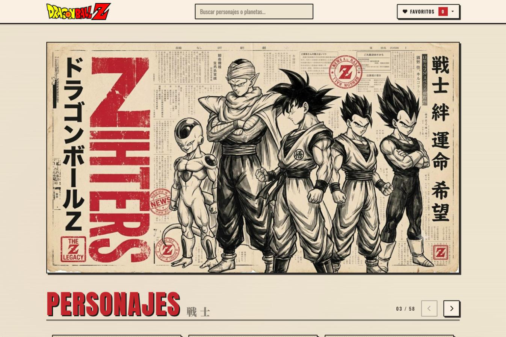
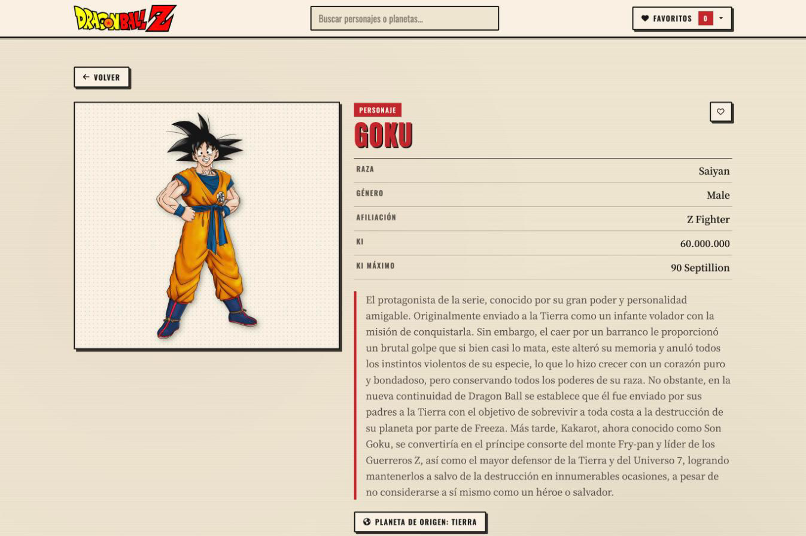
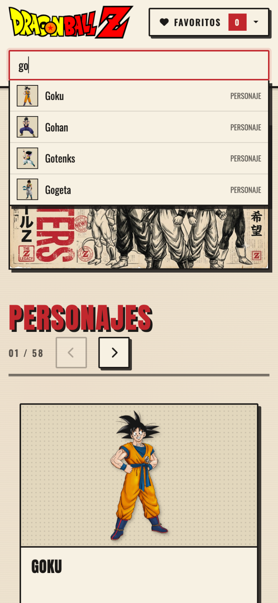

[English](README.md) | **Español**

# Blog de Dragon Ball Z

Un blog sobre los personajes y planetas de Dragon Ball Z, con la estética de un cartel de periódico japonés antiguo. Está hecho con React y Vite, con los datos de la [Dragon Ball API](https://dragonball-api.com), que es pública.

**Web publicada: [dragonballz-api.vercel.app](https://dragonballz-api.vercel.app)**



## Qué tiene

- **Personajes y planetas** en dos carruseles, con una ficha para cada uno: datos, descripción, planeta de origen, transformaciones y habitantes.
- **Buscador con sugerencias** en el navbar. Funciona con el ratón y con el teclado (flechas, Enter y Escape).
- **Favoritos** guardados en el navegador, que se mantienen al recargar. Sin cuentas ni base de datos.
- **Preparado para los fallos:** una página 404, una página de "no encontrado" para los ids que no existen y un botón de reintentar si fallan la API o la conexión. Si los datos de `localStorage` están corruptos, la app no se rompe.
- **Accesible:**
  - se puede usar con el teclado y con lector de pantalla;
  - foco visible, enlace para saltar al contenido y buscador con el patrón *combobox* de ARIA;
  - el carrusel saca del tabulador las tarjetas que no se ven.
- **Adaptado al móvil:** en el móvil, el buscador va en su propia fila y los carruseles muestran una tarjeta cada vez.

| Ficha de personaje | Buscador en el móvil |
| --- | --- |
|  |  |

## Tecnologías

| | |
| --- | --- |
| Interfaz | React 18.3 · React Router 7 |
| Build | Vite 8 |
| Estilos | Bootstrap 5.3 (rejilla y desplegable) y CSS propio · Font Awesome · Google Fonts |
| Calidad | ESLint 9 · GitHub Actions |
| Publicación | Vercel |

## Arrancarlo en local

Necesitas **Node 20.19 o superior**. Lo más fácil es abrir el repo en VS Code con la extensión **Dev Containers**: el contenedor ya trae Node, GitHub CLI y las extensiones del proyecto.

```bash
npm ci          # instala las versiones exactas de package-lock.json
npm run start   # servidor de desarrollo en http://localhost:3000
```

| Comando | Qué hace |
| --- | --- |
| `npm run start` | Servidor de desarrollo con recarga en caliente |
| `npm run build` | Versión de producción en `dist/` |
| `npm run preview` | Sirve en local la versión de producción |
| `npm run lint` | ESLint, sin permitir ningún aviso |

No hace falta ninguna variable de entorno: la API es pública.

## Estructura

```
src/
  pages/        Un componente por ruta: home, fichas de personaje y planeta, 404 y error
  components/   Navbar, buscador, carrusel, tarjetas, footer y mensajes de estado
  hooks/        Store global (Context + useReducer), peticiones a la API y título de la pestaña
  services/     Todas las llamadas a la Dragon Ball API
  store.js      El estado global: favoritos, listas y lo que se guarda en localStorage
  routes.jsx    Las rutas
```

## Cómo se trabaja

- **`main`** es producción y **`develop`** es donde se juntan y se prueban los cambios. Cada tarea es una issue de GitHub con su propia rama y su PR a `develop`.
- **Cada PR** pasa el lint y el build en GitHub Actions, y tiene su preview en Vercel.
- **Al hacer merge a `main`**, se publica en producción.

## Créditos

- Datos de la [Dragon Ball API](https://dragonball-api.com).
- El proyecto partió de la [plantilla de React de 4Geeks Academy](https://github.com/4GeeksAcademy/react-hello-webapp).
- Dragon Ball y sus personajes pertenecen a sus respectivos propietarios. Este es un proyecto de práctica sin fines comerciales.

## Licencia

[MIT](LICENSE)
