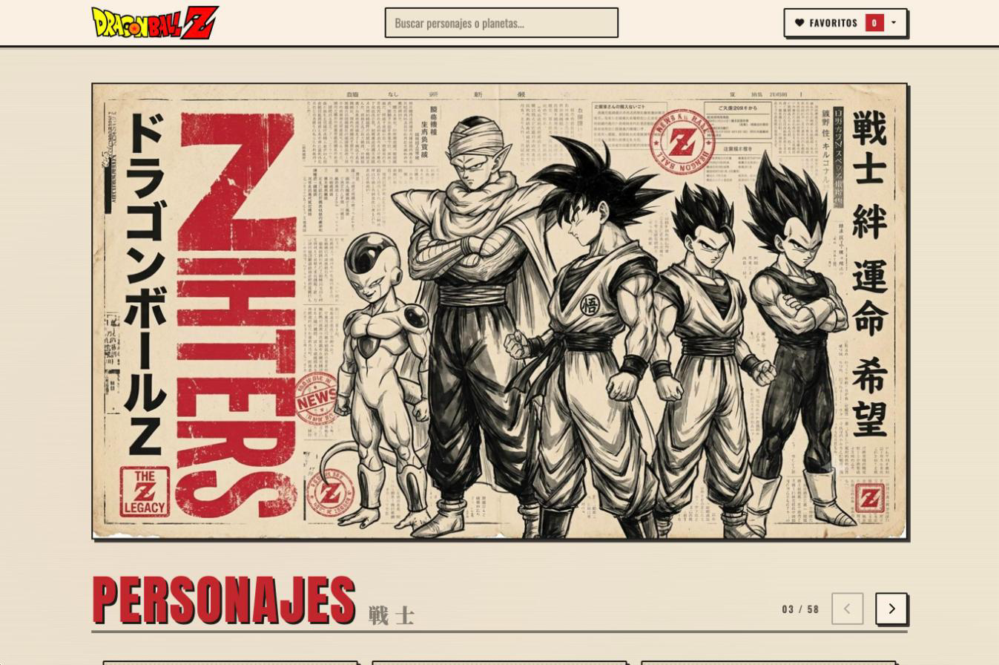
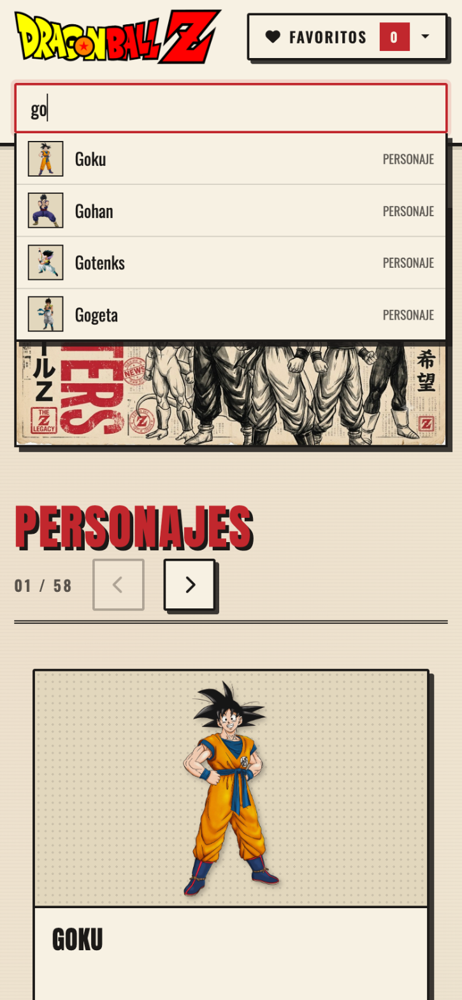

**English** | [Español](README.es.md)

# Dragon Ball Z Blog

A blog about the characters and planets of Dragon Ball Z, styled like an old Japanese newspaper poster. Built with React and Vite, using data from the public [Dragon Ball API](https://dragonball-api.com).

**Live site: [dragonballz-api.vercel.app](https://dragonballz-api.vercel.app)**



## Features

- **Characters and planets** in two carousels, with a detail page for each one: stats, description, home planet, transformations and inhabitants.
- **Search with suggestions** in the navbar. Works with the mouse and with the keyboard (arrow keys, Enter, Escape).
- **Favorites** saved in the browser, so they survive a reload. No account or database needed.
- **Built for failure:** a 404 page, "not found" pages for ids that don't exist, and a retry button when the API or the connection fails. Corrupt data in `localStorage` doesn't break the app.
- **Accessible:**
  - works with the keyboard and with screen readers;
  - visible focus, a skip link and an ARIA combobox for the search;
  - the carousel keeps hidden cards out of the tab order.
- **Responsive:** on phones the search gets its own row and the carousels show one card at a time.

| Character page | Search on mobile |
| --- | --- |
|  |  |

## Tech stack

| | |
| --- | --- |
| UI | React 18.3 · React Router 7 |
| Build | Vite 8 |
| Styles | Bootstrap 5.3 (grid and dropdown) and our own CSS · Font Awesome · Google Fonts |
| Quality | ESLint 9 · GitHub Actions |
| Hosting | Vercel |

## Running it locally

You need **Node 20.19 or newer**. The easiest way is to open the repo in VS Code with the **Dev Containers** extension: the container already has Node, the GitHub CLI and the project extensions.

```bash
npm ci          # install the exact versions from package-lock.json
npm run start   # development server at http://localhost:3000
```

| Command | What it does |
| --- | --- |
| `npm run start` | Development server with hot reload |
| `npm run build` | Production build in `dist/` |
| `npm run preview` | Serves the production build locally |
| `npm run lint` | ESLint, with zero warnings allowed |

No environment variables are needed: the API is public.

## Project structure

```
src/
  pages/        One component per route: Home, character and planet details, 404, error
  components/   Navbar, search, carousel, cards, footer and status messages
  hooks/        Global store (Context + useReducer), API requests, page title
  services/     Every call to the Dragon Ball API
  store.js      Global state: favorites, lists, and what gets saved in localStorage
  routes.jsx    The routes
```

## How we work

- **`main`** is production and **`develop`** is where work is merged and tested. Each task is a GitHub issue with its own branch and pull request to `develop`.
- **Every pull request** runs lint and build on GitHub Actions, and gets a Vercel preview.
- **Merging into `main`** publishes to production.

## Credits

- Data from the [Dragon Ball API](https://dragonball-api.com).
- The project started from the [4Geeks Academy React template](https://github.com/4GeeksAcademy/react-hello-webapp).
- Dragon Ball and its characters belong to their respective owners. This is a non-commercial practice project.

## License

[MIT](LICENSE)
